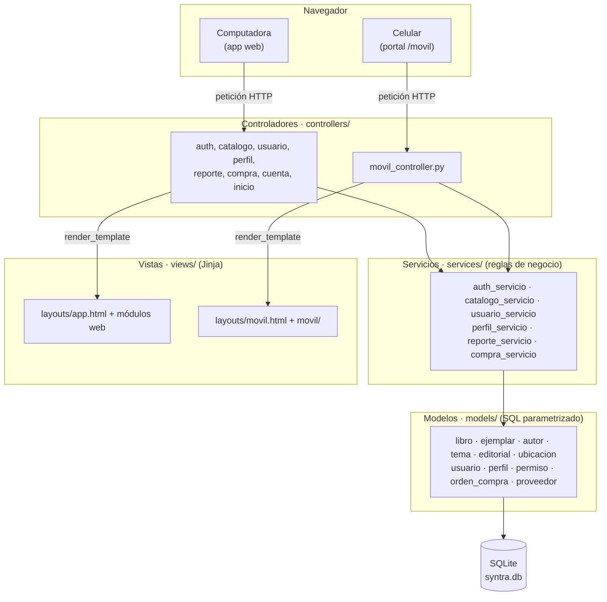
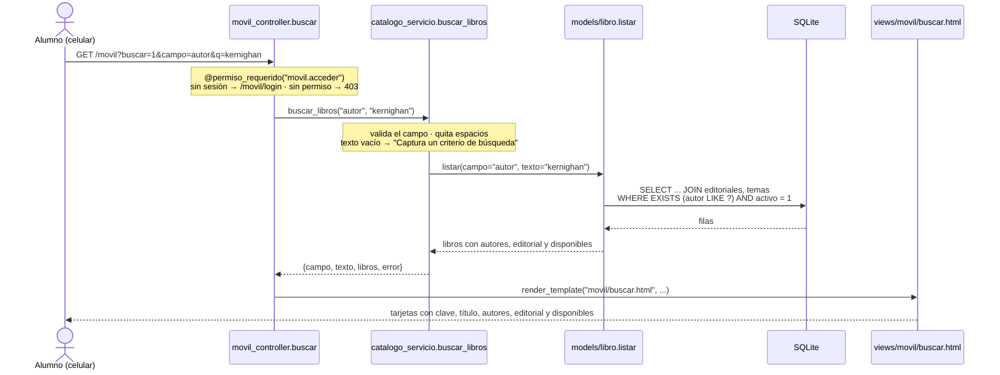

# Arquitectura · Patrón MVC con Flask

El sistema es **una sola aplicación Flask** con dos caras: la app web administrativa y el portal móvil para alumnos (`/movil`). Las dos usan **los mismos servicios y los mismos modelos**; lo único que cambia es el controlador y las vistas.

## Diagrama

## Qué archivo es qué

| Capa | Papel | Web | Portal móvil |
|---|---|---|---|
| **Modelo** | Acceso a datos. Solo SQL parametrizado, sin reglas. | `models/*.py` (compartido) | `models/*.py` (compartido) |
| **Servicios** | Reglas de negocio: validaciones, búsqueda, autenticación. Sin SQL ni Flask. | `services/*_servicio.py` (compartido) | `services/*_servicio.py` (compartido) |
| **Controlador** | Recibe la petición, llama al servicio y elige la vista. | `controllers/auth_controller.py`, `catalogo_controller.py`, `usuario_controller.py`, `perfil_controller.py`, `reporte_controller.py`, `compra_controller.py`, `cuenta_controller.py`, `inicio_controller.py` | `controllers/movil_controller.py` |
| **Vista** | Presenta los datos. Sin lógica de negocio. | `views/layouts/app.html`, `views/<módulo>/`, `views/components/ui.html` | `views/layouts/movil.html`, `views/movil/` (reusa `components/ui.html`) |
| **Estilos** | Design system con tokens. | `static/css/syntra.css` | `static/css/movil.css` sobre los tokens de `syntra.css` |

Piezas de apoyo: `app.py` (application factory y registro de blueprints), `config.py` (permisos, estados, límites y mensajes), `utils/seguridad.py` (sesión y `@permiso_requerido`), `utils/pdf.py` (PDF del listado), `init_db.py` (esquema y datos de prueba).

## Flujo de una búsqueda, de punta a punta

Ejemplo: un alumno busca "kernighan" por **Autor** en el celular.

En la web el recorrido es idéntico: `catalogo_controller.lista` llama al **mismo** `catalogo_servicio.buscar_libros`, y solo cambia la vista (`views/catalogo/lista.html`, una tabla en lugar de tarjetas). Por eso las reglas de HU-01-13 (clave exacta, demás campos por coincidencia sin acentos ni mayúsculas, texto vacío, sin resultados) se cumplen igual en las dos y se prueban una sola vez en `tests/test_busqueda.py`.

## Control de acceso

- Cada ruta protegida declara el permiso que necesita: `@permiso_requerido("catalogo.consultar")`.
- Los permisos están en la tabla `permisos` y se asignan a perfiles en `perfil_permisos`. El código revisa **códigos de permiso**, nunca nombres de perfil.
- El portal móvil exige `movil.acceder`, que solo tiene el perfil Alumno. Un profesor que intenta entrar ve "Acceso no autorizado: el portal móvil es solo para alumnos".
