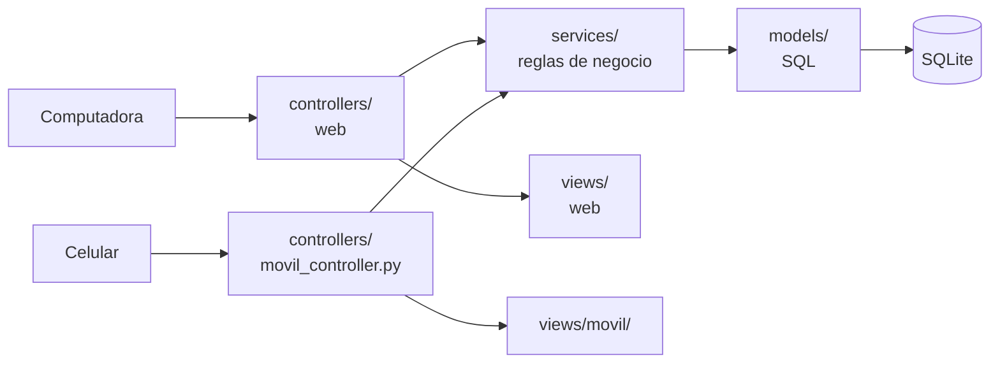

# Presentación · Construcción del prototipo (Ev09)

Todo lo que el equipo necesita para exponer la parte del código: arquitectura MVC, estándar, decisiones, guion de la demo y lecciones aprendidas. Para correr el proyecto, ver el [README](../README.md). Las pantallas están en [capturas/](capturas/).

## 1. Arquitectura MVC

Una sola app Flask con dos caras: la **web administrativa** y el **portal móvil para alumnos** (`/movil`). Las dos usan los mismos servicios y modelos; solo cambian el controlador y las vistas.

| Capa | Carpeta | Qué hace |
|---|---|---|
| Modelo | `models/` | Solo acceso a datos con SQL parametrizado. Compartido. |
| Servicios | `services/` | Validaciones, búsqueda y login. Sin SQL ni Flask. Compartido. |
| Controlador | `controllers/` | Recibe la petición, llama al servicio y elige la vista. Uno por módulo. |
| Vista | `views/` | Plantillas Jinja. La web y el móvil tienen su propio layout. |

**Ejemplo, una búsqueda en el celular:** `movil_controller.buscar` → `catalogo_servicio.buscar_libros("autor", "kernighan")` valida el texto → `models/libro.listar()` hace el `SELECT` con los joins → la vista `movil/buscar.html` pinta las tarjetas. La búsqueda web llama **al mismo servicio**; solo cambia la vista.

## 2. Estándar de código

- Nombres en español y consistentes con la BD (`libros`, `estante_id`, `apellido_paterno`).
- Un archivo por módulo en cada capa: `catalogo_controller.py` → `catalogo_servicio.py` → `models/libro.py`.
- PEP 8 revisado con **ruff**; docstring breve en cada módulo, servicio y modelo.
- Permisos, estados y límites en `config.py`; el acceso se revisa por permiso (`catalogo.consultar`), nunca por nombre de perfil.
- SQL siempre con parámetros `?`; contraseñas con hash; los errores nunca muestran la traza.
- Ramas y Pull Requests, nunca commit directo a `main`; commits cortos en español (`Esquema:`, `Web:`, `Móvil:`…).
- Pruebas automáticas con **pytest** (búsqueda, login, portal móvil, listado y pantallas web): `venv/bin/pytest` y `venv/bin/ruff check .`.

## 3. Decisiones

**Base de datos.** El esquema sigue el draw.io del Sprint 1 (autores N:M, estancias → estantes → ejemplares, permisos, proveedores). Corregimos tres errores del diseño en lugar de copiarlos:

| Tabla | Problema en el diseño | Corrección |
|---|---|---|
| `libro_autores` | Dos autores podían tener el mismo orden | `UNIQUE (libro_id, orden)` |
| `ejemplares` | Se podía guardar estante sin posición (ubicación a medias) | La ubicación va completa o vacía ("Ubicación no registrada") |
| `proveedores` | Dos proveedores con el mismo nombre | Nombre único |

**Portal móvil como web responsive, dentro del mismo Flask.** La propuesta de negocio lo define como "portal responsive de autoservicio"; así reutiliza todo el MVC sin duplicar lógica, funciona en Android y iPhone desde el navegador y se puede agregar a la pantalla de inicio. Solo entran alumnos, con el permiso `movil.acceder`.

## 4. Guion de la demo (≈ 4 min)

Antes: `venv/bin/python init_db.py`, `venv/bin/python app.py` y abrir en el celular la dirección que imprime la terminal.

**Web (≈ 1:45)**
1. Entrar con `visitante` / `Demo123` → se rechaza: perfil sin acceso.
2. Entrar con `admin` / `Admin123` → el menú muestra solo lo del perfil.
3. *Catálogo* → buscar por **Autor** `garcia marquez` (sin acentos), luego **Clave** `LIB-001` → *Ver ejemplares* → *Ver ubicación*.
4. *Listado de libros* → marcar algunos libros → *Imprimir* (solo salen los marcados).
5. *Perfiles y permisos* → "Acceder al portal móvil" solo lo tiene Alumno.

**Celular (≈ 2:00)**
1. Entrar con `profesor` / `Profe123` → "Acceso no autorizado: el portal móvil es solo para alumnos".
2. Entrar con `alumno` / `Alumno123` → saludo y libros disponibles.
3. Chip **Autor**, `kernighan` → tarjetas con autores, editorial y disponibles.
4. Chip **Título**, `zzz` → "No se encontraron libros" → **Limpiar**.
5. Buscar vacío → "Captura un criterio de búsqueda".
6. `paramo` → *Pedro Páramo* → EJ-0005 dice "Ubicación no registrada" → *Ver ubicación*.

**Plan B sin red:** abrir http://127.0.0.1:5050/movil en la laptop con la vista de celular del navegador (Chrome: `Cmd+Opción+I` y `Cmd+Shift+M`), o mostrar las capturas 06 a 13.

## 5. Lecciones aprendidas y propuesta de mejora

**Lecciones**
1. Cerrar el diseño de la BD antes de programar: normalizarla después obligó a tocar modelos, vistas y datos de prueba.
2. Separar las reglas en servicios permitió hacer el portal móvil sin duplicar la búsqueda ni el login.
3. Los criterios de aceptación se convirtieron en pruebas; correrlas antes de cada commit evitó romper lo que ya funcionaba.
4. Controlar el acceso por permisos y no por nombre de perfil hace fácil cambiar quién entra a qué.
5. Probar en un celular real desde temprano: el WiFi de la universidad puede bloquear la conexión.

**Propuesta de mejora para los siguientes sprints**
- Préstamos, reservas e historial del alumno desde el portal móvil.
- Pantallas para administrar autores, temas, editoriales y proveedores.
- Migraciones de BD para no perder datos al actualizar.
- Pruebas automáticas en cada Pull Request (GitHub Actions).
